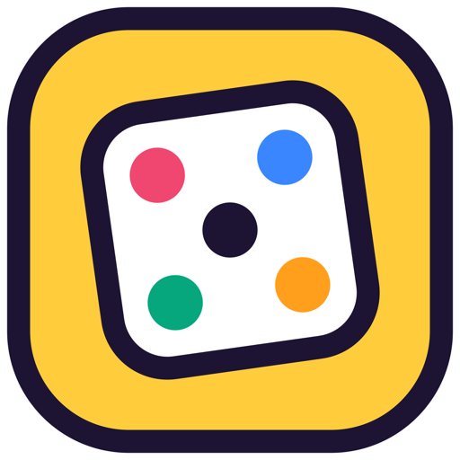
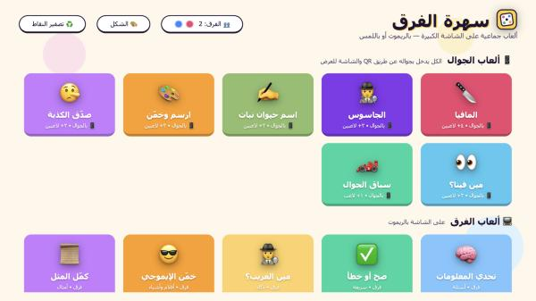

<h1 align="center">سهرة الفرق — Sahra Games</h1>

<b>٥٤ لعبة جماعية + ٦ أدوات لتلفزيونات وبروجكترات أندرويد</b> 
الشاشة الكبيرة تعرض اللعبة، والكل يلعب بالريموت أو من جواله بمسح QR — بدون تثبيت أي شي على الجوال، ومن أي شبكة (وبدون إنترنت يشتغل على نفس الواي فاي).

## ⬇️ التحميل
**[تحميل آخر إصدار — SahraGames.apk](https://github.com/24hmood24/SahraGames/releases/latest/download/SahraGames.apk)**

ثبّته على أي تلفزيون أو بروجكتر أو جهاز أندرويد تلفزيون (أندرويد ٥ وأحدث).

📺 **من التلفزيون مباشرة:** افتح تطبيق **Downloader** واكتب الكود **`8180399`**

## 🎮 الألعاب
**📱 بالجوال (١٥):** المافيا • الجاسوس • اسم حيوان نبات • ارسم وخمّن • صدّق الكذبة • مين فينا؟ • مين الأسرع؟ • حجر ورقة مقص • شد الحبل • ثعبان جماعي • سلسلة الكلمات • ٢٠ سؤال • حقيقتان وكذبة • قصة بالدور • سباق الجوال

**📺 على الشاشة (٣٩):** إكس أو • أربعة في صف • ذكاء الأوراق • تحدي ردة الفعل • تحدي الحساب • خمّن الرقم • تتابع التحديات • لا تترك البالون • تحدي المعلومات • صح أو خطأ • مين الغريب؟ • خمّن الإيموجي • كمّل المثل • بدون كلام • الكلمات الممنوعة • سباق الحروف • الكلمة المبعثرة • عجلة التحديات • الكرسي الساخن • ذاكرة الألوان • ألغاز • حقيقة أو جرأة • ما فعلتها أبدًا • لو خيروك • من أنا؟ • تحديات سريعة • بداية قصة • أسئلة تعارف • ٥ أشياء • الأعمى والمرشد • من ضحك خسر • كلمات الرسم • دوّار الزجاجة • الغميضة • تجمّد! • كراسي موسيقية • القنبلة الموقوتة • أوقف عند ١٠ • وش اللي اختفى؟

**🧰 أدوات (٦):** عجلة الأسماء • توزيع الفرق • نرد وعملة • مؤقت الجولات • لوحة النقاط • حرف الجولة

كل لعبة تقدر تلعبها **جماعي بالفرق** (بأسماء فرقكم) أو **فردي بالأسماء**، وكثير منها **بالجوال**. وفيه ٤ أشكال للتطبيق تختار منها.

---
من منتجات [دُجارا](https://dojara.com/sahra)
